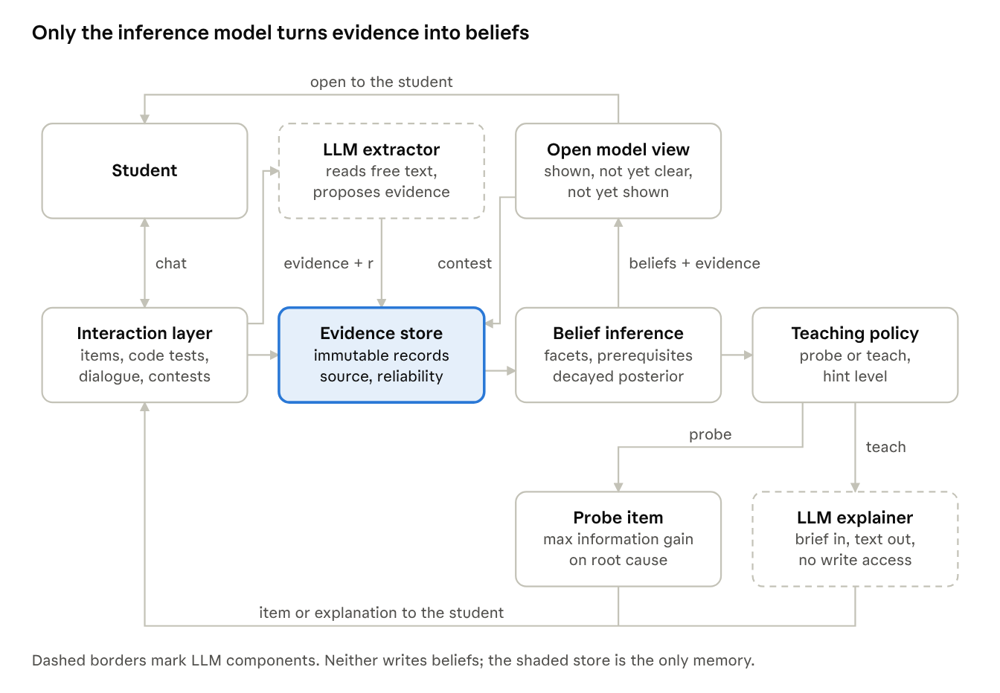
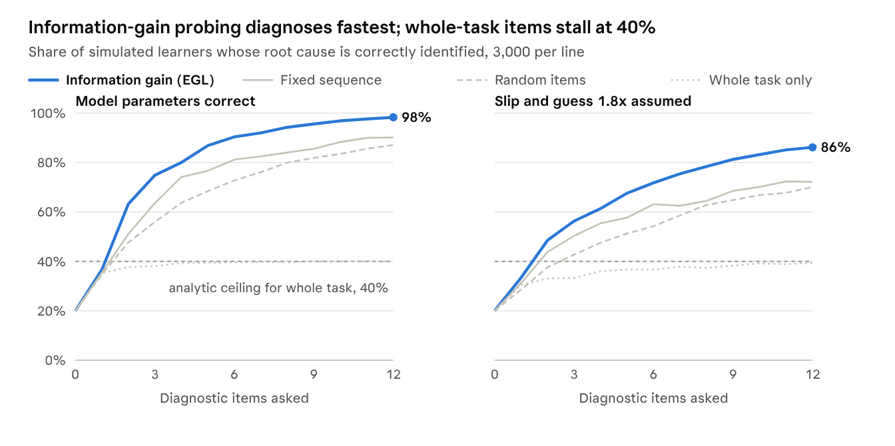

# Knowing Why a Student Struggles

**Evidence-Grounded, Contestable Learner Memory for LLM Tutors**

Diya Bhadane · research proposal, draft (November 2026)

LLM tutors increasingly remember students across sessions, usually as summaries or point scores that the LLM writes for itself. This project proposes the **Evidence-Grounded Learner model (EGL)**: the tutor's memory stores *evidence* (what was observed, from which source, how reliable it is), and beliefs about the student are *recomputed* from that evidence by a small probabilistic model. The model separates conceptual gaps, implementation gaps and missing prerequisites, keeps its uncertainty, discounts old evidence, and treats a student's objection as evidence to verify. The LLM proposes evidence and writes explanations but never writes beliefs.



## Status

| Part | Status |
| --- | --- |
| Literature review and research gap | Done (`paper/manuscript.md`, Sections 2–3) |
| Model specification | Done (Section 4) |
| Simulation study with synthetic learners | **Done** (`simulation/`, Section 5) |
| Classroom study with real students | **Proposed, not conducted** (Section 6) |

No learning outcome is claimed. All quantitative results come from simulated learners.

## Repository layout

```
paper/manuscript.md        full manuscript with references and appendices
figures/                   Figure 1 (architecture) and Figure 2 (simulation E1)
simulation/egl_sim.py      simulation code (Python 3, NumPy)
simulation/results.json    raw results from the run reported in the paper
requirements.txt
```

## Reproducing the simulation

```bash
pip install -r requirements.txt
cd simulation
python3 egl_sim.py results.json
```

The run takes about two minutes on a laptop. Seeds are fixed, so the numbers match Section 5.

| Experiment | What it tests |
| --- | --- |
| E1 | Question selection: information gain vs fixed sequence, random, whole-task only; plus a misspecified-parameter condition |
| E2 | Noisy LLM-labelled evidence, treated as clean vs reliability-weighted |
| E3 | Stale memory across sessions: carry, decay, reset |
| E4 | Student contests a belief: ignore, overwrite, verify |



## Citing

If you refer to this work, please cite the manuscript in `paper/manuscript.md`. References marked `[K]` in the bibliography still need a final check of page numbers and DOIs.
