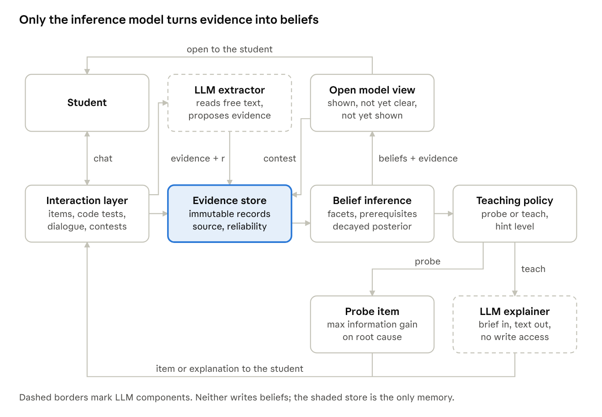
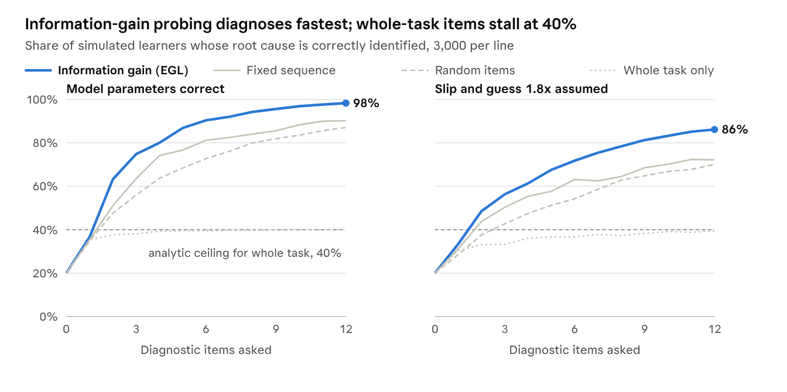

# Evidence-Grounded Learner Memory for LLM Tutors — Research Manuscript

Diya Bhadane · Draft, November 2026

## Knowing Why a Student Struggles: Evidence-Grounded, Contestable Learner Memory for LLM Tutors

**Author:** Diya Bhadane, Undergraduate, Department of Computer Science *(add institution)*

### Abstract

Large language model (LLM) tutors increasingly keep memories of individual students across sessions. In current designs those memories are usually free-text summaries or point estimates of mastery that the LLM itself writes and rewrites. Such a design has three weaknesses. It cannot say *why* a student fails a task, it cannot say how sure it is, and it gives the student no principled way to correct it. Two students who fail the same binary-search exercise, one because of off-by-one implementation errors and one because they do not understand why half the array can be discarded, need different teaching. A third student may lack the prerequisite, array indexing, altogether.

We propose the Evidence-Grounded Learner model (EGL), a learner memory for LLM tutors built on one rule: the memory stores *evidence*, and beliefs about the learner are always *recomputed* from that evidence by a transparent probabilistic model rather than written by the LLM. EGL represents each concept as separate conceptual and implementation facets linked by a prerequisite graph. It scores items with a DINA-style response model and tags every piece of evidence with its source and reliability. Older evidence is down-weighted by a power-prior decay, and the next diagnostic question is chosen by expected information gain over the root cause of failure. A student's objection to the model is recorded as weak evidence that triggers verification rather than an overwrite.

We report a completed simulation study with synthetic learners of known state (3,000 per condition). Information-gain probing identified the correct root cause in 90.3% of learners after six questions, compared with 81.2% for a fixed sequence, 72.7% for random questions and 39.6% when only whole-task coding exercises were observed. Weighting LLM-labelled dialogue evidence by its reliability lowered calibration error from 0.107 to 0.012. Two mechanisms carried explicit costs. Decay sped up recovery when a learner changed between sessions (8.5 vs 11.7 questions) but slowed confirmation when they had not (0.6 vs 0.3). Verifying a student's challenge rather than accepting it protected against mistaken claims (98.2% vs 73.1% accuracy) but was slower for honest ones (80.9% vs 90.8%). These results test only the inference machinery, not learning. We therefore specify a pre-registrable classroom study whose primary outcome is agreement between EGL's diagnoses and blinded expert diagnoses, with learning gain and retention as secondary outcomes.

**Keywords:** intelligent tutoring systems; learner modelling; knowledge tracing; cognitive diagnosis; large language models; long-term memory; open learner models; human-centred AI

## 1 Introduction

In Isaac Asimov's short story "The Fun They Had" \[1\], a child is taught at home by a mechanical teacher. When the girl keeps failing geography, an inspector adjusts the machine because it was set too fast for her age. In effect, the only adaptation is a speed dial. Nearly seventy-five years later, LLM tutors can explain almost anything in fluent language. Whether they can see *what a particular child needs* is a separate question. This paper is about that question.

Consider three students working on binary search. Student A understands why halving a sorted range works but writes loops with off-by-one bounds. Student B writes syntactically clean code but cannot explain why the left half may be discarded when the middle element is too large. Student C has not yet mastered array indexing, so neither the idea nor the code can land. All three may fail the same exercise, "implement binary search", with the same red test result. A tutor that sees only that outcome, or that summarises it as "weak at binary search", will give all three the same help. That help is right for at most one of them.

The ideal response is well understood in the learning sciences. Diagnose the cause, teach to it, and fade help as competence grows \[20\], \[21\]. Human one-to-one tutoring set the benchmark here \[2\]. Intelligent tutoring systems (ITS) approach it only when they track fine-grained skills explicitly \[3\]. LLM tutors are different. They are trained on web text rather than on a model of the student, and a recent benchmark found that even strong models adapt only weakly to student errors when given the information that an ITS would use \[27\]. Developers have responded by giving LLM tutors memory, such as persona summaries, event logs and knowledge-tracing scores retrieved into the prompt \[29\], \[30\]. Memory alone does not solve diagnosis. A 2026 benchmark of long-term tutoring found that LLMs retrieve historical evidence well but struggle to turn it into an accurate diagnosis and an adaptive teaching action \[31\].

We argue that the problem lies partly in *what the memory holds and who is allowed to write it*. When an LLM writes "student struggles with binary search" into memory and later rewrites that sentence, three things are lost. The first is the evidence the claim rested on. The second is how strong that evidence was. The third is any chance for the student to dispute the claim on the record. The result is a learner model that may be confidently wrong, may never notice that the student has changed, and may harden a mistaken label over many sessions. That outcome is especially undesirable when the model is meant to inform teaching rather than ranking.

**Contribution.** This paper contributes one design idea and its evaluation plan: *learner memory as an evidence store from which beliefs are recomputed, never as beliefs written by the LLM.* We instantiate it as the Evidence-Grounded Learner model (EGL), which has four mechanisms:

1. Each concept is split into conceptual and implementation **facets**, linked by **prerequisite** edges, so that failure can be attributed to a root cause.
2. Every observation is stored with its **provenance and reliability**, and beliefs are recomputed by Bayesian inference with **power-prior decay** of older evidence.
3. The tutor chooses the next diagnostic question by **expected information gain** over the root cause.
4. A student's challenge to the model is treated as **weak evidence that triggers verification**, not as an overwrite and not as noise.

None of these mechanisms is new on its own; Section 2 cites each source. What we claim is new is their combination as the learner memory of an LLM tutor, and an evaluation centred on *diagnostic validity and correctability* rather than on dialogue quality alone.

**What is and is not completed.** Section 5 reports a simulation with synthetic learners that tests whether the inference behaves as intended, including where it fails. Section 6 specifies a classroom study that has not been conducted. No learning outcome is claimed for EGL in this paper.

## 2 Background and Related Work

The literature has already solved some of the problems in our original vision and leaves others open. We group it into seven strands and close with a comparison matrix. Papers marked *preprint* had not been peer reviewed when checked.

### 2.1 Tutoring effectiveness and why diagnosis matters

Bloom reported that one-to-one human tutoring with mastery learning raised achievement by about two standard deviations over conventional classes \[2\]. That "2 sigma" figure came from small studies and is an upper bound, not a typical effect. VanLehn's review of controlled comparisons found that human tutoring produced about 0.79 SD over no tutoring. Step-based ITS reached a similar 0.76 SD, while answer-based systems that judged only final answers were much weaker \[3\]. The lesson for us is about granularity: systems that observe and respond to *steps* rather than final outcomes come close to human tutors. Our binary-search scenario is a granularity problem. A single pass/fail on "implement binary search" is an answer-level signal.

### 2.2 Knowledge tracing

Bayesian Knowledge Tracing (BKT) models each skill as a hidden binary state with learn, slip and guess parameters, updated after each practice opportunity \[4\]. Deep Knowledge Tracing (DKT) replaced the hand-built model with a recurrent network and reported large gains in next-answer prediction \[5\]. A later analysis showed that BKT extended with forgetting, individual ability and skill interactions matched DKT. This suggests that interpretable structure was not the bottleneck \[6\]. Pelánek's review lays out the main families, including BKT, logistic models and their extensions, and their trade-offs \[7\]. Individualised BKT fits per-student parameters \[47\].

Two limitations matter here. First, knowledge-tracing models are usually judged by prediction accuracy (AUC). A model can predict well yet tell the teacher little about the *cause* of failure. Second, parameter estimates can be ambiguous. Beck and Chang showed that different BKT parameter sets can fit the same data, so prior assumptions shape the inferred knowledge state \[8\]. Doroudi and Brunskill showed that a misspecified tracing model can give some groups of students systematically less practice than they need, an equity problem rather than a mere accuracy problem \[9\]. For programming, Code-DKT added features extracted from submitted code. It noted that one wrong attempt may contain a trivial syntax slip while another reveals a misconception, but correctness labels treat them alike \[10\]. Its best AUC was about 0.74, leaving considerable room for improvement \[10\].

### 2.3 Cognitive diagnosis and bug models

Psychometrics offers a direct tool for "which sub-skill is missing". Cognitive diagnosis models such as DINA pair each item with a Q-matrix row listing the skills it requires. A student answers correctly with probability 1 − slip if they hold every required skill, and with probability guess otherwise \[11\], \[12\]. DINA is static: it assumes no learning during testing, and it depends heavily on a correct Q-matrix \[12\]. Earlier still, BUGGY modelled children's subtraction errors as specific procedural "bugs" rather than missing knowledge \[13\]. Introductory-programming research documents many such difficulties, separating misconceptions from other sources of difficulty \[14\]. We adopt DINA's response model because it lets one exercise provide evidence about several facets at once. We add learning dynamics, decay and source reliability, which DINA lacks.

### 2.4 LLM-based tutoring

The evidence on LLM tutors is mixed, and the mix is informative. In a field experiment with nearly a thousand high-school students, unrestricted GPT-4 access improved practice performance but *lowered* later unassisted exam performance. A version with learning safeguards largely removed the harm \[23\]. A randomised trial in a Harvard physics course found that a carefully designed AI tutor produced larger learning gains than an active-learning class, in less time \[24\]. The two studies differ in many ways. Together they suggest that pedagogical design, not model capability alone, decides whether students learn.

Other work exposes specific failure modes. MathDial found that LLMs prompted as tutors often give factually incorrect feedback or reveal solutions too early \[25\]. Tutor CoPilot gave live suggestions to human tutors in a randomised trial of about 900 tutors and 1,800 students, and students of lower-rated tutors benefited most (*preprint*) \[26\]. Its authors note that LMs lack contextual knowledge such as a student's previous interactions \[26\]. Borchers and Shou tested whether LLMs respond to the student-state information an ITS uses and found only marginal adaptivity \[27\].

### 2.5 Memory and learner state in LLM tutors

General-purpose LLM memory systems store and retrieve past interactions. MemoryBank adds a forgetting mechanism inspired by the Ebbinghaus curve \[33\]; MemGPT manages context in tiers (*preprint*) \[34\]; generative agents store observations and synthesise "reflections" \[35\]. All of these build on retrieval-augmented generation \[36\]. These systems are designed to make a conversation partner coherent. They are not designed to make judgements about the user accurate, and their memories are mostly LLM-written text. Agent memory is also an attack surface: AgentPoison showed that a few injected records can steer an agent reliably \[37\].

Tutoring-specific work is closer to ours. Scarlatos, Baker and Lan used an LLM to label knowledge components and correctness in tutor–student dialogues, then ran knowledge tracing on those labels \[28\]. TutorLLM feeds a BERT-based knowledge-tracing estimate and retrieved course content into GPT-4 (*preprint*) \[29\]. TASA keeps a persona bank and an event memory, adds a forgetting score to DKT mastery, and has an LLM rewrite retrieved memories to reflect forgetting. It was evaluated with LLM-simulated students only (*preprint*) \[30\]. LongTutor benchmarks long-term tutoring in three stages, evidence acquisition, diagnosis and teaching, and finds the main weakness at the diagnosis stage \[31\]. A 2026 synthesis of LLM tutoring warns that a learner state can be accurate yet unused, and that a wrong knowledge-component inventory yields estimates that are internally consistent but educationally wrong (*preprint*) \[32\]. The same synthesis lists open or contestable learner models as outside its scope.

### 2.6 Open, negotiated and inspectable learner models

The AIED community has long argued that students should see their learner models. The SMILI framework classifies open learner models by what is shown, to whom and how \[15\], \[16\]. STyLE-OLM went further and treated diagnosis as a dialogue in which learner and system discuss and jointly revise the model. Its study reported better model quality and more learner reflection \[17\]. Bull argued that negotiation can keep models accurate when they draw on many data sources \[18\]. Zapata-Rivera and Greer let students and teachers inspect Bayesian student models directly \[19\]. This strand predates LLMs. Its central insight is that letting the learner challenge the model can make the model *more* accurate as well as more respectful, and it has not been carried into LLM-tutor memory.

### 2.7 Assistance, fading and dependence

Koedinger and Aleven's "assistance dilemma" names the open problem of when to give and when to withhold help \[20\]. The expertise reversal effect shows that guidance that helps novices can hinder more knowledgeable learners \[21\]. Students also seek help poorly, which motivated explicit models of help-seeking \[22\]. The Bastani et al. results \[23\] show the cost of ignoring these findings with generative AI. A learner model that is wrong about what the student knows will mis-time help in either direction.

### 2.8 Literature comparison matrix

The matrix compares representative systems on the properties our gap rests on. "Partly" means the property is present in a limited form described in Section 2.

| Work | Type, year | Learner state | Cause of failure (facet or prerequisite) | Represents uncertainty | Persistent memory | Learner can inspect or contest | Evaluation |
| --- | --- | --- | --- | --- | --- | --- | --- |
| BKT \[4\] | Journal, 1994 | P(mastery) per skill | No | Partly (one probability) | Yes (skill estimates) | No | Real student data |
| DKT \[5\] | NeurIPS, 2015 | RNN hidden state | No | No | Yes | No | Prediction on public datasets |
| Code-DKT \[10\] | EDM, 2022 | RNN + code features | Partly (code content) | No | Yes | No | Prediction, 410 CS1 students |
| DINA \[11\], \[12\] | Journal, 2001/2009 | Binary skill profile | Yes (Q-matrix) | Yes (posterior) | No (static test) | No | Psychometric data |
| STyLE-OLM \[17\] | IJAIED, 2003 | Belief model, conceptual graphs | Partly | Partly | Yes | Yes, by negotiation | User study |
| Inspectable Bayesian models \[19\] | IJAIED, 2004 | Bayesian network | Partly | Yes | Yes | Inspect | User study |
| MemoryBank \[33\] | AAAI, 2024 | Text memories + decay | No | No | Yes | No | Simulated dialogues |
| Dialogue KT, LLMKT \[28\] | LAK, 2025 | KT on LLM-labelled turns | Partly (KCs) | Partly | Within dialogue | No | Two dialogue datasets |
| TutorLLM \[29\] | Preprint, 2025 | BERT-based KT estimate | No | No | Yes | No | Deployed as a browser extension with student users |
| TASA \[30\] | Preprint, 2025 | Persona + events + DKT + forgetting | No | No (point estimates) | Yes, LLM-rewritten | No | LLM-simulated students |
| LongTutor \[31\] | ACL, 2026 | Benchmark, not a model | Tests diagnosis | n/a | Long histories | n/a | Expert-annotated logs |
| **EGL (this paper)** | Proposal, 2026 | Facet × prerequisite posterior from an evidence store | Yes | Yes (posterior, calibrated) | Yes, evidence not beliefs | Yes, as evidence + verification | Simulation (done); classroom study (proposed) |

Two patterns stand out. Rows that diagnose causes well (DINA, OLM work) are static or pre-LLM. Rows that are LLM-native keep memory but store point estimates or LLM-written text, and none lets the learner contest it. That is the space Section 3 examines.

## 3 Research Gap, Problem Statement and Contribution

### 3.1 What is already established

Most of the fourteen capabilities in our original vision are not new as capabilities. Tracking mastery over time is the purpose of knowledge tracing \[4\], \[5\]. Adjusting difficulty and fading hints are core ITS behaviours, and their limits are studied under the assistance dilemma and expertise reversal \[20\], \[21\]. Prerequisite-aware sequencing and sub-skill diagnosis exist in psychometrics \[11\], \[12\]. Cross-session memory for LLMs exists in several forms \[33\]–\[35\], and so do LLM tutors that consume knowledge-tracing estimates \[29\], \[30\]. A paper claiming "an adaptive, memory-driven AI tutor" would therefore be claiming a category, not a contribution.

### 3.2 What remains unresolved

Three problems sit where these strands meet and are not addressed together by any system we found.

1. **Cause-level diagnosis in LLM tutors.** LLM-tutor memories record *that* a student struggles, usually per knowledge component. They do not separate a conceptual gap, an implementation gap and a missing prerequisite \[29\], \[30\]. Diagnosis is the weakest stage of long-term LLM tutoring \[31\]. Cognitive diagnosis models can make this separation, but they are static and have not been joined to LLM-tutor memory \[12\].
2. **Epistemic status of memory.** When an LLM writes and rewrites its own beliefs about a learner, the evidence behind each belief, its strength and its age are lost. Point estimates hide uncertainty \[30\]. Mistaken or injected records can persist and steer later behaviour \[37\]. Learner models can also be wrong in ways that fall unevenly across students \[9\]. A tutor that acts on its own beliefs can also create a feedback loop. If it decides a student is weak at X, it may stop offering the items that would show otherwise, as algorithmic confounding does in recommender systems \[44\]. Without uncertainty, the tutor cannot know when to ask rather than teach.
3. **Correctability by the learner.** Open and negotiated learner models showed that letting students challenge the model can improve its accuracy \[17\], \[18\]. LLM-tutor memories are not open in this sense, and a recent synthesis does not treat contestability as part of the tutoring loop \[32\]. The naive fix, letting the student overwrite the model, fails whenever the student is mistaken about themselves. Overconfidence after AI-assisted practice has been documented \[23\].

**The gap.** No current LLM-tutor learner memory both (a) attributes failure to a conceptual, implementation or prerequisite cause with calibrated uncertainty and (b) keeps that attribution grounded in inspectable, decaying evidence that the learner can contest without being able to simply overwrite it. Existing work also lacks an evaluation that measures *diagnostic validity* of the memory, rather than the fluency or learning gain of the whole tutor.

### 3.3 Three candidate contributions

We considered three narrower contributions before choosing one.

- **C1. Explanation-failure detection.** A bandit that learns, per student, which explanation strategy (visual, worked example, debugging) works, and switches when one fails.
- **C2. Evidence-grounded, facet-level learner memory (EGL).** The design summarised in Section 1.
- **C3. Dependence-aware assistance fading.** A policy that reduces hint levels to limit over-reliance, evaluated on unassisted performance.

| Criterion | C1 Explanation-failure bandit | C2 Evidence-grounded memory (chosen) | C3 Dependence-aware fading |
| --- | --- | --- | --- |
| Originality | Moderate; strategy bandits exist in ITS research | Moderate to high as a combination; each part has precedent | Low to moderate; close to assistance-dilemma work \[20\] and guardrail designs \[23\] |
| Technical depth | Moderate | High: inference, decay, reliability, active diagnosis | Moderate |
| Feasibility for an undergraduate | Low: needs many interactions per student to learn | High: small discrete model, exact inference, runs on a laptop | High |
| Experimental testability | Weak: per-student data too sparse in a short study | Strong: diagnosis can be checked against ground truth in simulation and against blinded experts in class | Strong, but outcome is mostly learning gain, which needs large samples |
| Academic significance | Moderate | High: addresses the stage LongTutor finds weakest \[31\] and joins OLM ideas to LLM memory | Moderate; already partly addressed \[23\] |
| Fit with Human-Centred AI | Moderate | High: uncertainty, transparency, contestability | High |

C2 is the strongest on testability and depth. It is also a prerequisite for C1 and C3: a fading policy or strategy switch is only as good as the learner model that triggers it. We therefore make C2 the central contribution. C3's hint ladder appears in Section 4.8 as a consumer of the learner model, not as a separate claim, and C1 is left as future work.

### 3.4 Problem statement

Given a stream of heterogeneous observations of one student, the tutor must maintain a belief over which facets of a target concept and its prerequisites the student has mastered. Observations include graded items, code test results, LLM-interpreted dialogue turns and the student's own claims. The belief must be calibrated, must reflect that older evidence may be stale, must be recomputable from stored evidence, and must accept a student's challenge as information without being captured by it. The tutor must use this belief to decide whether to *probe* (ask a diagnostic question) or *teach*, and what to teach.

### 3.5 Objectives

- **O1.** Specify EGL's representation, inference and probing policy formally enough to implement and replicate.
- **O2.** Test in simulation whether EGL's inference identifies root causes faster than common question-selection baselines, stays calibrated under noisy evidence, and behaves predictably when memory is stale or contested.
- **O3.** Design a classroom study that measures diagnostic validity against blinded experts as the primary outcome, and learning as secondary.
- **O4.** State the human-centred design requirements, including openness, contestability and non-labelling, that the representation must satisfy.

### 3.6 Scope of the novelty claim

We do not claim that facet models, information-gain item selection, decay or open learner models are new. Each is cited above, and adaptive testing has selected items by information for decades \[42\], \[43\]. We claim three narrower things. The first is the specific design rule that an LLM tutor's learner memory should store provenance-tagged evidence while beliefs are recomputed, never written by the LLM. The second is a concrete instantiation of that rule that joins cognitive-diagnosis structure, reliability weighting, power-prior decay and contestation-as-evidence. The third is an evaluation framed around diagnostic validity and correctability. If a reviewer finds an existing system that already does all of this for LLM tutors, our contribution reduces to the evaluation and the simulation analysis. Our search did not find one.

## 4 The Evidence-Grounded Learner Model (EGL)

### 4.1 Design principles

- **P1. Evidence, not verdicts.** Memory stores what was observed, when and from which source. Beliefs are a function of the evidence and can be recomputed at any time.
- **P2. The LLM may propose evidence but never write beliefs.** LLM interpretations of free text enter as evidence with a measured reliability. The probabilistic model alone turns evidence into beliefs.
- **P3. Uncertainty is first-class.** The tutor acts on the full posterior: when it is unsure, it asks.
- **P4. Beliefs are about demonstrated knowledge of specific facets, never about ability.** No variable in the model represents a student's general aptitude or speed.
- **P5. The learner can see and contest the model, and a contest is evidence.**

### 4.2 Architecture

EGL sits between the interaction layer and the LLM. Information flows in one direction for beliefs: observations become evidence records, evidence becomes a posterior, and the posterior drives the policy. The LLM appears twice, as an evidence extractor with a reliability score and as a constrained explanation generator, but it has no write access to the belief store.



*Figure 1. EGL architecture.*

Observations enter on the left. LLM output reaches the evidence store only as reliability-weighted records, and the open model and contest path close the loop with the student.

### 4.3 Concept–facet graph and item bank

An instructor authors a small directed acyclic graph per topic. Nodes are skills k = 1..K. A target concept contributes two nodes, a conceptual facet and an implementation facet. Edges point from prerequisites to the skills that depend on them. For binary search the minimal graph has K = 3 nodes: arrays and indexing (Ar), binary-search conceptual (Bc) and binary-search implementation (Bi), with Ar as a prerequisite of both facets. Each item j in the bank carries a Q-vector q\_j ∈ {0,1}^K of required skills, a slip s\_j and a guess g\_j \[11\]. Items are chosen to *separate* facets. "Which half can be discarded?" requires Ar and Bc. "Fix this off-by-one bug" requires Ar and Bi. "Write binary search from scratch" requires all three and therefore separates nothing.

### 4.4 Evidence store

Each observation is one immutable record:

```json
{
  "id": "ev-0193",
  "student": "s-17",
  "time": "2026-11-20T15:02:11+05:30",
  "session": 3,
  "item": "bs-fix-offbyone-02",
  "q": {"Ar": 1, "Bc": 0, "Bi": 1},
  "outcome": 0,
  "source": "unit_tests",
  "reliability": 1.0,
  "raw_ref": "submissions/s-17/1193.java",
  "note": "fails on single-element array"
}
```

Sources include graded items, unit-test runs, LLM-labelled dialogue turns, student self-reports and instructor annotations. Records are never edited. A correction is a new record, so the full history stays auditable. The student can view every record that affects a belief about them.

### 4.5 Belief inference

Let z ∈ {0,1}^K be the student's latent mastery profile. The prior encodes prerequisites: a skill is unlikely to be mastered when one of its prerequisites is not.

```latex
\pi(z) = \prod_{k=1}^{K} P\left(z_k \mid z_{\mathrm{pa}(k)}\right), \qquad P\left(z_k = 1 \mid z_{\mathrm{pa}(k)}\right) = \begin{cases} \theta_k^{+} & \text{if all parents mastered} \\ \theta_k^{-} & \text{otherwise} \end{cases}
```

Here pa(k) are the prerequisites of k and θ⁺ > θ⁻. In our simulation θ⁺ = 0.5, θ⁻ = 0.1 and P(Ar = 1) = 0.7. Item responses follow DINA \[11\], \[12\]. Let η\_j(z) = 1 if z contains every skill item j requires:

```latex
\eta_j(z) = \prod_{k} z_k^{\,q_{jk}}, \qquad P(y = 1 \mid z, j) = (1 - s_j)^{\eta_j(z)} \, g_j^{\,1 - \eta_j(z)}
```

This is the standard conjunctive assumption. A student who lacks any required skill answers correctly only by guessing, and one who has them all fails only by slipping.

**Source reliability.** Suppose an evidence source, such as an LLM labelling a dialogue turn, reports the wrong outcome with probability ε. Then the observed label ỹ has likelihood (1 − ε)P(y|z) + ε(1 − P(y|z)). This rearranges to a mixture with a coin flip:

```latex
\tilde P(\tilde y \mid z, j) = r \, P(\tilde y \mid z, j) + \frac{1 - r}{2}, \qquad r = 1 - 2\varepsilon
```

So r = 1 for a trusted grader and r → 0 for a source no better than chance. The value of ε for an LLM extractor is estimated once, by comparing its labels with human labels on a held-out set, in the way Scarlatos et al. validated their labeller \[28\].

**Decay of older evidence.** People learn and forget between sessions, so old evidence should count for less. We use a power prior \[48\], which raises the likelihood of each historical observation to a weight w ∈ \[0, 1\]:

```latex
p(z \mid \mathcal{E}, \tau) \;\propto\; \pi(z) \prod_{n \in \mathcal{E}} \tilde P\left(y_n \mid z, j_n\right)^{w_n}, \qquad w_n = \exp\left(-\lambda \, (\tau - t_n)\right)
```

Here τ is the current time and t\_n the time of observation n. A weight of 1 keeps the evidence at full strength; 0 discards it. Because the evidence is kept, decay is reversible. Changing λ changes the beliefs without losing data. This is the main practical advantage of P1 over LLM-rewritten memory, where a forgotten detail is gone. The simulation uses a single weight w = 0.3 for all evidence from the previous session.

**Learning within a session.** After a teaching move on skill k, the posterior is pushed through a BKT-style transition P(z\_k: 0 → 1) = ℓ\_k \[4\], with no transition from 1 to 0 within a session. The diagnostic simulation in Section 5 holds the state fixed, because it tests diagnosis before teaching.

**Exact inference.** For the local subgraph around one target concept, K is small (3 to about 10), so the posterior is computed exactly over all 2^K profiles. With K = 10 that is 1,024 states, which takes milliseconds.

### 4.6 Root cause and diagnostic probing

The quantity the teacher cares about is the root cause, not the full profile. We define a deterministic map D = c(z) to five classes: *prerequisite gap* (Ar = 0), *implementation gap* (Bc = 1, Bi = 0), *conceptual gap* (Bc = 0, Bi = 1), *both facets missing* and *mastered*. In larger graphs, c(z) returns the earliest unmastered node in topological order within the target's prerequisite closure, labelled by facet.

The next diagnostic item maximises the expected reduction in uncertainty about D, a standard criterion for experimental design \[42\] that is also used in adaptive testing \[43\]:

```latex
j^{*} = \arg\max_{j} \left[ H(D) - \sum_{y \in \{0,1\}} \tilde P(y \mid j) \, H(D \mid y, j) \right]
```

The target is D, not z. Information about distinctions that would not change the teaching decision is not rewarded. For a student whose prerequisite gap is already clear, EGL stops asking about facets. Diagnostic items are not wasted time for the student either, since answering questions is itself a form of retrieval practice that aids retention \[46\].

### 4.7 The probe-or-teach decision

The tutor probes while it is uncertain and teaches when it is confident. Let p̂ = max\_c P(D = c). If p̂ < κ and the best information gain exceeds δ, the tutor asks the item j\*. Otherwise it teaches to the most probable cause. Both κ (we suggest 0.8) and δ are tunable. A probing budget caps diagnostic questions per session, so the student is not interrogated.

### 4.8 Pedagogical policy

The policy is deliberately simple and rule-based, because the paper's claim is about the learner model, not about the policy.

| Most probable cause | Teaching move | Binary-search example |
| --- | --- | --- |
| Prerequisite gap | Remediate the prerequisite first, then return | Zero-based index tracing; reading a\[mid\] for a given mid |
| Conceptual gap | Explain why the method works, with a visual and a prediction task | Shrinking-interval diagram; "after this comparison, which indices can still contain the target?" |
| Implementation gap | Targeted failing test plus variable trace | Run on a one-element array; trace lo, hi, mid; state the loop invariant as a comment |
| Both facets missing | Conceptual first, then implementation | As above, in that order (an assumption to test) |
| Mastered | Transfer task | Lower-bound search, or search on a monotone function |

**Hint ladder and fading.** Hints run from level 0 (prompt to self-explain) through location pointer, facet-specific hint and partial worked step to level 4 (full worked example). The starting level falls as P(z\_k = 1) for the relevant facet rises, following the expertise reversal effect \[21\]. The level drops after each unaided correct step. Level 4 requires a prior attempt, the guardrail that limited harm in \[23\].

**Recognising an ineffective explanation.** After a teaching move on facet k, the next item is a check on k. If P(z\_k = 1) has not risen by at least δ\_learn after two moves with the same strategy, the tutor switches strategy. It logs a record that the strategy was ineffective for this student and facet. This is evidence about the *strategy*, not about the student.

### 4.9 Constrained LLM roles

1. **Evidence extractor.** It maps a free-text answer or a code submission to (item-like Q-vector, outcome, confidence). Its output is a record with source = "llm\_extractor" and reliability r estimated offline.
2. **Explanation generator.** It receives a structured brief: topic, most probable cause and its probability, chosen strategy, hint level and a prohibition on revealing full solutions below level 4. It returns the student-facing text. It never receives write access to evidence or beliefs.

This separation follows from P2. A hallucinated summary or an injected record \[37\] cannot silently become a belief. At worst it becomes one low-reliability observation that later evidence can outweigh.

### 4.10 Contestation protocol

When the student says "I already know indexing", EGL does three things.

1. It records the claim as evidence with source = "self\_report" and a likelihood ratio Λ in favour of z\_k = 1. The simulation uses Λ = 2, which is weak.
2. It schedules up to two verification items that bear mainly on skill k.
3. It tells the student what will happen: "Thanks, that changes my estimate. Two quick questions will confirm it, and then we'll move on."

Overwriting would make the model hostage to mistaken self-assessment. Ignoring the claim would make the openness of the model decorative. The trade-off between these is measured in Section 5.

### 4.11 Algorithm

```text
Algorithm 1  EGL tutoring loop for one target concept
input: graph G, item bank {(q_j, s_j, g_j)}, evidence store E, params (kappa, delta, lambda, budget)
1  loop each turn:
2    post <- infer(prior(G), E, now, lambda)            # Sec 4.5, exact over 2^K
3    if student contested skill k:
4       E.append(self_report(k, LR=2)); queue verify(k) x2
5    pD <- class_posterior(post)                         # Sec 4.6
6    if queue not empty: j <- queue.pop(); ask(j)
7    elif max(pD) < kappa and budget > 0 and max_j IG(j) > delta:
8       j <- argmax_j IG(j); ask(j); budget <- budget - 1
9    else:
10      cause <- argmax(pD)
11      move  <- policy(cause, hint_level(post, cause))  # Sec 4.8
12      text  <- LLM_generate(brief(move, cause, pD))     # LLM has no write access
13      show(text); queue check(cause)
14   obs <- observe()                                    # grader, tests, or LLM extractor
15   E.append(record(obs, source, reliability))          # immutable
16   show_open_model(pD, evidence_links)                 # Sec 7
```

### 4.12 Alternatives considered

- **DKT or attention-based KT as the belief model.** These predict well with large data \[5\], but they do not expose facet-level causes or calibrated posteriors, and they need training data that a new course lacks. BKT-scale structure can match their accuracy \[6\].
- **Letting the LLM maintain a free-text student profile.** This is the simplest design, and it is the baseline for the classroom study. It fails P1 to P3 by construction.
- **Full POMDP teaching policies.** These optimise teaching as planning under uncertainty \[41\]. They are more principled than our rule-based policy, but much harder to specify and validate for an undergraduate project. They are a natural extension once the learner model is validated.
- **Learning θ, s and g from data.** EM estimation of DINA parameters is standard \[12\], but identifiability issues \[8\] argue for informative priors at small scale. We start with expert-set parameters and plan to refit after the pilot.

## 5 Simulation Study (Completed)

The simulation asks one question: *does EGL's inference behave as designed when the truth is known?* It does not test learning, engagement or the LLM. Every learner is synthetic.

### 5.1 Setup

- **Skills and classes.** K = 3 (Ar, Bc, Bi). Synthetic learners are drawn equally from the five root-cause classes of Section 4.6, with 600 learners per class and 3,000 per condition.
- **Item bank.** Seven item types with expert-set Q-vectors, slips and guesses: index arithmetic (Ar; s = 0.10, g = 0.20); which half to discard, multiple choice (Ar, Bc; 0.10, 0.25); explain the invariant (Bc; 0.15, 0.20); trace midpoints by hand (Ar, Bc; 0.10, 0.10); fix an off-by-one bug (Ar, Bi; 0.15, 0.15); fix a termination condition (Ar, Bi; 0.15, 0.10); write binary search against unit tests (Ar, Bc, Bi; 0.20, 0.05).
- **Responses.** Generated from the DINA model. The learner's state is fixed within the diagnostic phase.
- **Model prior.** θ⁺ = 0.5, θ⁻ = 0.1, P(Ar = 1) = 0.7. This prior is deliberately *not* the uniform class distribution that generated the learners, so the model starts mildly misspecified.
- **Metrics.** Diagnostic accuracy, meaning the most probable class equals the true class. Also the Brier score of the class posterior (lower is better) and expected calibration error (ECE, 10 bins) of the top-class probability.
- **Precision.** With 3,000 learners, the 95% confidence half-width of any accuracy is at most ±1.8 percentage points.
- **Reproducibility.** Python 3 with NumPy; seeds 1–4 and 11. The script, about 200 lines, is available on request and should be released with the paper.

### 5.2 Conditions

- **E1, probe selection.** Four question-selection policies use identical inference: EIG (Section 4.6), random items, a fixed instructor-style cycle through all items, and whole-task only (repeated "write binary search"). E1 is run twice: once with the true slip and guess equal to the model's, and once *misspecified*, with the true slip and guess 1.8 times larger than the model assumes.
- **E2, noisy evidence.** Three EIG-chosen graded items, then nine LLM-labelled dialogue observations on random items whose labels flip with probability ε = 0.25. The noisy labels are either treated as clean (r = 1) or reliability-weighted (r = 1 − 2ε = 0.5). A third condition uses the three graded items alone.
- **E3, stale memory.** Session 1 runs eight EIG items on a prerequisite-gap learner. Between sessions the learner either learns indexing, moving to the *both facets missing* class, or does not change. Session 2 counts the items needed until the top class is correct with probability ≥ 0.8, capped at 15. Memory policies: carry the full posterior, decay old evidence with w = 0.3, or reset to the prior.
- **E4, contestation.** The model starts confident (P = 0.9) that the prerequisite is missing. The learner claims to know indexing. The claim is honest for implementation-gap learners and mistaken for prerequisite-gap learners. Policies: ignore the claim, overwrite (multiply the prerequisite-missing states by 0.01), or verify (likelihood ratio 2 plus two forced indexing items). Six items follow in every case.

### 5.3 Results

**E1: information-gain probing diagnoses faster.** Figure 2 shows accuracy as items accumulate. With well-specified parameters, EIG reached 90.3% after six items and 98.3% after twelve. The fixed cycle reached 81.2% and 90.1%, and random selection 72.7% and 87.0%. The Brier score after six items was 0.15 for EIG, against 0.29 for the fixed cycle and 0.36 for random. Whole-task observation flattened at 39.6% to 40.0%. That matches the analytic ceiling: a single conjunctive item separates "mastered" from "not mastered" but not the four failure classes, so with five equal classes the best achievable accuracy is 0.2 + 0.2 = 0.4. This is the simulation counterpart of the Introduction's claim that a red test result cannot tell Students A, B and C apart.



*Figure 2. Simulation E1 (egl_sim.py, seeds 1 and 11, 3,000 learners per line).*

Under misspecification every policy degraded. EIG fell to 71.8% after six items and 86.1% after twelve, and its ECE rose from 0.004 to 0.070. EIG still led the fixed cycle (63.1%, 72.2%) and random (54.2%, 70.1%). The ranking is robust, but the calibration claim is not: when the response model is wrong, the posterior becomes overconfident. Section 6 therefore includes a calibration check on real data.

**E2: reliability weighting keeps the model honest.**

| Evidence used | Accuracy | Brier | ECE | Mean top-class confidence |
| --- | --- | --- | --- | --- |
| 3 graded items only | 74.5% | 0.368 | 0.029 | 0.743 |
| + 9 noisy labels treated as clean | 72.8% | 0.395 | 0.107 | 0.835 |
| + 9 noisy labels, reliability-weighted | 78.3% | 0.303 | 0.012 | 0.780 |

Treating noisy LLM labels as clean made the model *more confident and less accurate* than ignoring them altogether. Weighting the same labels by their reliability added accuracy and cut calibration error almost ninefold. This is the strongest single argument for P2, because it is exactly what happens when an LLM's interpretation of a student is written into memory as fact.

**E3: decay is a compromise, not a free win.**

| Memory policy | Learner changed: items to re-diagnose | Learner changed: unresolved after 15 | Learner unchanged: items to confirm |
| --- | --- | --- | --- |
| Carry full posterior | 11.7 | 31.3% | 0.26 |
| Decay (w = 0.3) | 8.5 | 3.1% | 0.58 |
| Reset to prior | 6.6 | 0.7% | 3.33 |

Carrying memory at full strength was best when the learner had not changed and worst when they had: almost a third of changed learners were still misdiagnosed after 15 items. Resetting was the reverse. Decay sat between them, giving up about a third of an item when nothing changed in exchange for avoiding most of the failures when something did. The right weight depends on how often learners change between sessions, which is an empirical question about real students.

**E4: verification protects against mistaken claims at a cost to honest ones.**

| Policy | Honest claim: P(true state) before items | Honest: accuracy after 3 / 6 items | Mistaken claim: P(true state) before items | Mistaken: accuracy after 3 / 6 items |
| --- | --- | --- | --- | --- |
| Ignore | 0.10 | 71.4% / 80.3% | 0.90 | 99.5% / 99.3% |
| Overwrite | 0.92 | 76.9% / 90.8% | 0.08 | 65.1% / 73.1% |
| Verify (EGL) | 0.18 | 73.1% / 80.9% | 0.82 | 95.6% / 98.2% |

No policy dominated. Overwriting was best for honest students and worst for mistaken ones. Ignoring was the mirror image. Verification stayed near the better outcome for mistaken claims (98.2%) but gained little over ignoring for honest claims (80.9% vs 80.3%). With Λ = 2 the claim barely moves a confident prior, so the extra benefit comes almost entirely from the two forced items. A larger Λ or more verification items would shift the balance. This result matters for the human-centred argument. Contestability alone does not guarantee that an honest student is believed quickly, and Section 7 treats it as a requirement on the interface as well as on the model.

### 5.4 What the simulation does and does not show

It shows that the inference is internally sound and that the information-gain policy finds root causes efficiently when items separate facets. It also shows that reliability weighting matters, and that decay and contestation involve real trade-offs that should be tuned rather than assumed. It does *not* show that real students' errors fit the DINA structure, that an LLM extractor reaches any particular ε, that diagnosis improves learning, or that students accept the probing. Learners generated from the model's own family make the study partly circular, which the misspecified condition only partly addresses. Those questions require the study in Section 6.

## 6 Research Questions, Hypotheses and Proposed Human Study (Not Yet Conducted)

### 6.1 From the preliminary questions to the refined ones

The four preliminary questions in the original brief were reasonable, but they were too broad to test the contribution. RQ1 compared "adapted" with "standardised" tutoring. A positive result would not show *which* part of the adaptation helped, and a null result would not show whether the learner model was even correct. RQ2 and RQ3 overlapped. RQ4 on retention and independence is important, but it is downstream of diagnosis and would need a much longer study to power. The refined questions put the learner model's validity first and learning second.

- **RQ1 (diagnostic validity).** How closely do EGL's root-cause diagnoses for binary search agree with those of blinded expert raters, and are its probabilities calibrated on real students?
- **RQ2 (memory design).** Compared with an LLM-maintained free-text profile given the same observations, does EGL's evidence-grounded memory produce more accurate and better-calibrated diagnoses in later sessions?
- **RQ3 (correctability).** When students contest the model, how often are they right, and does verification resolve the disagreement in the correct direction more often than overwriting would have?
- **RQ4 (learning, secondary).** Does tutoring driven by EGL improve unassisted post-test, seven-day retention and transfer compared with a tutor using the same LLM without EGL?

### 6.2 Hypotheses

- **H1.** Agreement between EGL's most probable class and the expert consensus exceeds chance-corrected agreement of κ = 0.40 (moderate). Its ECE on real students is below 0.10.
- **H2.** EGL's session-2 diagnoses agree with experts more often than diagnoses from the free-text-profile baseline. The test is McNemar's on paired diagnoses of the same students' logs.
- **H3.** Among contested beliefs that verification items resolve, the share where the student was right lies strictly between 0 and 1. This means neither always-overwrite nor always-ignore is correct. Verification reaches the expert-agreed state more often than counterfactual overwriting.
- **H4.** Students tutored with EGL score higher on the unassisted delayed post-test than students tutored without it, adjusting for pre-test. The expected effect is small (d ≈ 0.3), so H4 is treated as exploratory unless the sample allows adequate power.

H1 to H3 test the contribution itself. H4 tests whether the contribution matters for learning, and a null on H4 would not falsify H1 to H3.

### 6.3 On the three-group design

The brief proposed three groups: conventional material (A), a general-purpose LLM tutor (B) and the adaptive framework (C). A versus C confounds many things at once, including interactivity, feedback, time on task and novelty, so it cannot isolate the learner model. We keep the contrast that answers the research question and an ablation that isolates the memory.

- **B. LLM tutor, no persistent learner model.** Same LLM, same item bank and same pedagogical prompt, but no memory across sessions.
- **B+. LLM tutor with an LLM-written free-text profile.** Same as B, plus a profile the LLM updates after each session. This is the realistic current practice \[30\].
- **C. LLM tutor with EGL.** Same LLM and items, with beliefs, probing and policy from EGL.

Group A, conventional material, can be included as a reference if the course team wants it, but no hypothesis depends on it. RQ1 to RQ3 can be answered within Group C and by *replaying* B+'s logs offline, so they need far fewer participants than RQ4.

### 6.4 Participants and sample size

We propose undergraduate CS1 or CS2 students for whom binary search is part of the course, recruited on a voluntary basis with no grade consequence.

- **RQ1.** To estimate Cohen's κ with a 95% confidence interval of about ±0.15 when κ ≈ 0.6, roughly 60 to 80 diagnosed students are needed. The exact number depends on class balance and should be confirmed with a κ sample-size routine before pre-registration.
- **RQ4.** A two-group comparison at d = 0.5, α = 0.05 and power 0.80 needs 64 per group \[49\]. With a pre-test that correlates r ≈ 0.5 with the post-test, ANCOVA reduces this by about the factor 1 − r². That gives roughly 48 per group, or about 100 across B and C. For d = 0.3 the requirement rises above 130 per group, which is why H4 is labelled exploratory.
- **Assumption.** These figures are planning estimates, not results.

### 6.5 Randomisation and control

Students are randomised individually, stratified by pre-test tercile, using a sealed allocation list generated before recruitment. The LLM, temperature, system prompt, item bank, interface and session length are identical across groups, and only the learner-model component differs. Students are not told which condition they are in. Raters are blind to condition and to EGL's output.

### 6.6 Procedure (three sessions over ten days)

1. **Day 0, 50 minutes.** Consent, a 15-minute pre-test (arrays, binary-search concepts, implementation) and tutoring session 1.
2. **Day 2 or 3, 40 minutes.** Tutoring session 2 and the immediate post-test.
3. **Day 9 or 10, 30 minutes.** Delayed post-test and a transfer task (lower-bound search). There is no tutor access during tests.

Sessions record all items, code submissions, dialogue, hint levels, EGL posteriors and contest events.

### 6.7 Measures

| Construct | Measure | Used for |
| --- | --- | --- |
| Root cause, ground truth | Two blinded raters code each student's session-1 work and a short think-aloud into the five classes; disagreements resolved by discussion; inter-rater κ reported | RQ1–RQ3 |
| Diagnostic agreement | Cohen's κ between EGL (or B+) and the expert consensus | H1, H2 |
| Calibration | ECE and Brier of EGL's class posterior against expert labels; reliability diagram | H1 |
| Prediction | AUC and log-loss for the next graded item, compared with the free-text baseline's judgement | Supporting |
| Correctability | Contest count, verification outcome, time to resolution, student-rated fairness (5-point) | H3 |
| Learning | Pre-, immediate and delayed post-test, with separate conceptual and implementation subscales | H4 |
| Transfer | Unassisted lower-bound search task scored by unit tests and a rubric | H4 |
| Independence | Hints per correct step; share of steps at hint level ≤ 1 in session 2 | Exploratory |
| Experience | Short survey on perceived usefulness, trust and feeling labelled | Exploratory |

The tests are written by the course team, piloted with 8 to 10 students outside the study, and checked for floor and ceiling effects.

### 6.8 Analysis plan

- **H1.** κ with a bootstrap 95% CI; ECE and Brier with bootstrap CIs; a reliability diagram.
- **H2.** McNemar's test on paired correct or incorrect diagnoses.
- **H3.** Descriptive proportions with exact binomial CIs. The counterfactual overwrite outcome is computed by replaying the log with the overwrite rule.
- **H4.** ANCOVA of delayed post-test on condition with pre-test as covariate, plus a mixed model with student random intercepts across the two post-tests. Effect sizes are reported with CIs.
- **Multiplicity.** Holm correction across H1 to H3. H4 and the exploratory measures are reported without correction and labelled as such.
- **Pre-registration.** Hypotheses, exclusions (for example, fewer than ten items completed) and analyses are registered before data collection.

### 6.9 Ethics, consent and privacy

The study requires approval from the institution's ethics committee before any recruitment. Consent is opt-in, with the right to withdraw and delete data at any point. Logs are pseudonymised at collection, and the key is held separately by the course team. Dialogue sent to any external LLM provider is stripped of names and identifiers, and the provider's data-retention terms are checked and stated in the consent form. Students under 18 are excluded. In India, processing must comply with the Digital Personal Data Protection Act, 2023; the exact obligations should be confirmed with the institution's data-protection officer.

### 6.10 Reproducibility

We will release the simulation code, the EGL implementation, the item bank with Q-vectors and parameters, prompts, the rater codebook and anonymised aggregate results. Raw dialogue will not be released without separate consent.

## 7 Human-Centred and Ethical Considerations

A learner model is a set of claims about a person. EGL is designed so that those claims are narrow, revisable and visible, and this section sets out what follows from that. Shneiderman's framing of human-centred AI asks for high automation *and* high human control \[39\]. The Microsoft human–AI interaction guidelines ask systems to make clear how well they can do what they do and to support efficient correction \[38\]. Both translate into concrete requirements here.

**No fixed labels.** EGL has no variable for ability, speed or intelligence (P4). Its outputs are statements of the form "current evidence suggests you have not yet shown X", tied to a facet and a date. Because evidence decays, an old failure stops counting against a student, by design. Interface text never uses words like "weak" or "slow", and the open model shows a trajectory rather than a single score.

**Communicating uncertainty.** The open learner model shows each facet in plain words with three bands: "shown", "not yet clear" and "not yet shown". Each band links to the evidence records behind it. Numeric probabilities are available on request. "Not yet clear" is deliberately prominent, because it explains why the tutor is asking a question rather than teaching. Showing it is itself a form of honesty about the system's limits \[38\].

**Student control.** Students can (a) view all evidence about them, (b) contest any belief, which triggers the protocol in Section 4.10, (c) annotate a record, for example "I was rushing", which is stored as context rather than deleting the record, and (d) delete their whole history. E4 showed that contesting a confident wrong belief is not resolved instantly, so the interface tells the student how many verification questions remain. A teacher can review contests the system did not resolve.

**Incorrect estimation and bias.** A misspecified model can under-serve some groups systematically \[9\]. Students who write less, write in a second language or explain informally may be scored lower by an LLM extractor. EGL's response is to measure the extractor's error rate separately for relevant groups, such as language background, and to apply group-specific reliability or retrain where rates differ. A further safeguard is to never let extractor-only evidence move a facet to "not yet shown" without at least one graded item. These checks are part of the study's analysis, not an afterthought.

**Dependence and autonomy.** The Bastani et al. field experiment showed that unrestricted assistance can raise practice performance while lowering independent performance \[23\]. EGL's hint ladder requires an attempt before full solutions, fades as mastery rises and measures independence directly. The probing budget limits how much the system tests rather than teaches, which also respects the student's time.

**Privacy and memory transparency.** Persistent memory about students is sensitive educational data. EGL stores only task-relevant evidence. It stores no affect inferences, no demographic data in the learner model and no free-text summaries of the student as a person. Records are pseudonymised, and retention is limited to the course. Sending dialogue to an external LLM requires stripping identifiers and checking provider terms. Students are told plainly what is remembered, for how long and why.

**Security of memory.** Because beliefs are recomputed from typed, source-tagged evidence, a single injected or hallucinated record has bounded influence. Its weight is capped by source reliability, and it is visible in the audit trail. This is a mitigation, not a guarantee, against memory poisoning of the kind shown for general agents \[37\].

**Accessibility.** The open model must work with screen readers, so bands are text, not colour alone. Probing items should offer alternatives to timed or typing-heavy formats where those are not the skill being assessed.

**Human oversight.** Instructors author the graph and item bank, review aggregate diagnoses and see unresolved contests. The system recommends; it does not grade.

## 8 Limitations, Expected Contributions and Conclusion

### 8.1 Limitations

1. **No human data yet.** All quantitative results come from synthetic learners generated by a model of the same family as EGL. The misspecified condition shows the results are not entirely self-fulfilling, but it is no substitute for real students.
2. **Authoring cost and Q-matrix validity.** EGL needs an instructor-authored facet graph and item Q-vectors, and diagnostic models are sensitive to Q-matrix errors \[12\]. A wrong or coarse skill inventory gives estimates that are consistent but educationally wrong \[32\]. This limits EGL to well-defined topics until skill and Q-matrix induction are reliable.
3. **Conjunctive response assumption.** DINA assumes a student lacking any required skill can only guess. Real students may compensate, for example by debugging by trial and error without understanding. A compensatory or generalised model would be more realistic but harder to identify.
4. **Scale.** Exact inference over 2^K states is feasible only for local subgraphs. A full course needs factorised or approximate inference.
5. **Two facets may be too few.** "Conceptual" and "implementation" are a useful first cut for programming, but implementation itself hides distinct difficulties, such as bounds, termination and overflow of (lo + hi). The facet split is a modelling choice to validate, not a fact about cognition.
6. **Rule-based policy.** The teaching policy is hand-written, so H4 tests EGL plus this policy, not EGL alone.
7. **Contestation tuning.** E4 shows that the chosen Λ and number of verification items favour robustness over speed for honest students. The right setting depends on how accurate real students' self-assessments are, which RQ3 will measure.
8. **Single topic.** Binary search is a good test bed because its facets are well understood. Whether the approach generalises to less structured topics, such as essay writing or design, is open.

### 8.2 Expected contributions

If the proposed study is carried out, the paper would contribute the following.

- **A design rule for LLM-tutor memory.** Store evidence and recompute beliefs; the LLM proposes but never writes. The rule is supported by simulation evidence that writing noisy LLM judgements as fact makes the model overconfident and less accurate (E2).
- **EGL**, a concrete and replicable instantiation. It combines facet-level cognitive diagnosis, source reliability, power-prior decay, information-gain probing and contestation-as-evidence.
- **An evaluation protocol** that measures what a learner model is for: agreement with expert diagnosis, calibration and correctability, with learning as a downstream outcome.
- **Measured trade-offs** for decay and contestation, giving future systems settings to tune rather than assume.

### 8.3 Future work

The next steps are, in order: run the pilot and the RQ1 to RQ3 study; fit s, g and θ from pilot data; replace the rule-based policy with a learned or POMDP-based policy \[41\] once the learner model is validated (candidate C1); test spaced review scheduled from the decayed posterior \[40\], \[45\]; and study how students actually use contestation, including whether it supports self-regulated learning as open learner models have suggested \[15\].

### 8.4 Conclusion

Asimov's mechanical teacher could only be made faster or slower. Today's LLM tutors can say almost anything, but saying the right thing to Student A, B or C requires knowing which of them is in front of the tutor, how sure that judgement is, and whether it is out of date. We argued that the way LLM tutors currently remember students, through LLM-written summaries and point estimates, makes this hard. We proposed instead that the memory hold evidence, and that beliefs be recomputed from it, kept uncertain and opened to the student's challenge. A simulation shows that the inference behaves as intended and exposes the costs of its two most human-facing mechanisms. Whether it helps real students is the question the proposed study is designed to answer.

## References

IEEE style. **\[V\]** means the title, authors, venue and year were checked against the publisher, the ACL Anthology, arXiv or an index during drafting (November 2026). **\[K\]** means the details are standard bibliographic data that were not re-checked online in this pass; confirm the page numbers and DOI before submission. Preprints are labelled.

&#91;1\] I. Asimov, "The Fun They Had," short story, first published 1951; included as Chapter 1 of the NCERT Class 9 English textbook *Beehive*. \[K\]

&#91;2\] B. S. Bloom, "The 2 sigma problem: The search for methods of group instruction as effective as one-to-one tutoring," *Educational Researcher*, vol. 13, no. 6, pp. 4–16, 1984. \[K\]

&#91;3\] K. VanLehn, "The relative effectiveness of human tutoring, intelligent tutoring systems, and other tutoring systems," *Educational Psychologist*, vol. 46, no. 4, pp. 197–221, 2011. \[K\]

&#91;4\] A. T. Corbett and J. R. Anderson, "Knowledge tracing: Modeling the acquisition of procedural knowledge," *User Modeling and User-Adapted Interaction*, vol. 4, no. 4, pp. 253–278, 1994 (often cited as 1995). \[K\]

&#91;5\] C. Piech, J. Bassen, J. Huang, S. Ganguli, M. Sahami, L. Guibas, and J. Sohl-Dickstein, "Deep knowledge tracing," in *Advances in Neural Information Processing Systems 28*, 2015. \[K\]

&#91;6\] M. Khajah, R. V. Lindsey, and M. C. Mozer, "How deep is knowledge tracing?" in *Proc. 9th Int. Conf. Educational Data Mining (EDM)*, 2016. \[V\]

&#91;7\] R. Pelánek, "Bayesian knowledge tracing, logistic models, and beyond: An overview of learner modeling techniques," *User Modeling and User-Adapted Interaction*, vol. 27, pp. 313–350, 2017. \[K\]

&#91;8\] J. E. Beck and K. Chang, "Identifiability: A fundamental problem of student modeling," in *User Modeling 2007*, LNCS vol. 4511, Springer, 2007, pp. 137–146. \[V\]

&#91;9\] S. Doroudi and E. Brunskill, "Fairer but not fair enough: On the equitability of knowledge tracing," in *Proc. 9th Int. Conf. Learning Analytics & Knowledge (LAK)*, 2019, pp. 335–339, doi: 10.1145/3303772.3303838. \[V\]

&#91;10\] Y. Shi, M. Chi, T. Barnes, and T. W. Price, "Code-DKT: A code-based knowledge tracing model for programming tasks," in *Proc. 15th Int. Conf. Educational Data Mining (EDM)*, 2022. \[V\]

&#91;11\] B. W. Junker and K. Sijtsma, "Cognitive assessment models with few assumptions, and connections with nonparametric item response theory," *Applied Psychological Measurement*, vol. 25, no. 3, pp. 258–272, 2001. \[K\]

&#91;12\] J. de la Torre, "DINA model and parameter estimation: A didactic," *Journal of Educational and Behavioral Statistics*, vol. 34, no. 1, pp. 115–130, 2009, doi: 10.3102/1076998607309474. \[V\]

&#91;13\] J. S. Brown and R. R. Burton, "Diagnostic models for procedural bugs in basic mathematical skills," *Cognitive Science*, vol. 2, no. 2, pp. 155–192, 1978. \[K\]

&#91;14\] Y. Qian and J. Lehman, "Students' misconceptions and other difficulties in introductory programming: A literature review," *ACM Transactions on Computing Education*, vol. 18, no. 1, art. 1, 2017. \[K\]

&#91;15\] S. Bull and J. Kay, "Student models that invite the learner in: The SMILI open learner modelling framework," *International Journal of Artificial Intelligence in Education*, vol. 17, no. 2, pp. 89–120, 2007. \[V\]

&#91;16\] S. Bull and J. Kay, "SMILI☺: A framework for interfaces to learning data in open learner models, learning analytics and related fields," *International Journal of Artificial Intelligence in Education*, vol. 26, no. 1, pp. 293–331, 2016, doi: 10.1007/s40593-015-0090-8. \[V\]

&#91;17\] V. Dimitrova, "STyLE-OLM: Interactive open learner modelling," *International Journal of Artificial Intelligence in Education*, vol. 13, no. 1, pp. 35–78, 2003. \[V\]

&#91;18\] S. Bull, "Negotiated learner modelling to maintain today's learner models," *Research and Practice in Technology Enhanced Learning*, 2016, doi: 10.1186/s41039-016-0035-3. \[V\]

&#91;19\] J.-D. Zapata-Rivera and J. E. Greer, "Interacting with inspectable Bayesian student models," *International Journal of Artificial Intelligence in Education*, vol. 14, no. 2, pp. 127–163, 2004. \[V\]

&#91;20\] K. R. Koedinger and V. Aleven, "Exploring the assistance dilemma in experiments with Cognitive Tutors," *Educational Psychology Review*, vol. 19, no. 3, pp. 239–264, 2007, doi: 10.1007/s10648-007-9049-0. \[V\]

&#91;21\] S. Kalyuga, P. Ayres, P. Chandler, and J. Sweller, "The expertise reversal effect," *Educational Psychologist*, vol. 38, no. 1, pp. 23–31, 2003. \[V\]

&#91;22\] V. Aleven, B. McLaren, I. Roll, and K. Koedinger, "Toward meta-cognitive tutoring: A model of help seeking with a Cognitive Tutor," *International Journal of Artificial Intelligence in Education*, vol. 16, no. 2, pp. 101–128, 2006. \[K\]

&#91;23\] H. Bastani, O. Bastani, A. Sungu, H. Ge, Ö. Kabakcı, and R. Mariman, "Generative AI without guardrails can harm learning: Evidence from high school mathematics," *Proceedings of the National Academy of Sciences*, vol. 122, no. 26, e2422633122, 2025, doi: 10.1073/pnas.2422633122. \[V\]

&#91;24\] G. Kestin, K. Miller, A. Klales, T. Milbourne, and G. Ponti, "AI tutoring outperforms in-class active learning: An RCT introducing a novel research-based design in an authentic educational setting," *Scientific Reports*, vol. 15, art. 17458, 2025, doi: 10.1038/s41598-025-97652-6. \[V\]

&#91;25\] J. Macina, N. Daheim, S. P. Chowdhury, T. Sinha, M. Kapur, I. Gurevych, and M. Sachan, "MathDial: A dialogue tutoring dataset with rich pedagogical properties grounded in math reasoning problems," in *Findings of the Association for Computational Linguistics: EMNLP 2023*, 2023, pp. 5602–5621, doi: 10.18653/v1/2023.findings-emnlp.372. \[V\]

&#91;26\] R. E. Wang, A. T. Ribeiro, C. D. Robinson, S. Loeb, and D. Demszky, "Tutor CoPilot: A human-AI approach for scaling real-time expertise," arXiv:2410.03017, 2024 (preprint; also Annenberg EdWorkingPaper, doi: 10.26300/81nh-8262). \[V\]

&#91;27\] C. Borchers and T. Shou, "Can large language models match tutoring system adaptivity? A benchmarking study," in *Artificial Intelligence in Education (AIED 2025)*, LNCS vol. 15878, Springer, 2025. \[V\]

&#91;28\] A. Scarlatos, R. S. Baker, and A. Lan, "Exploring knowledge tracing in tutor-student dialogues using LLMs," in *Proc. 15th Int. Learning Analytics and Knowledge Conf. (LAK25)*, 2025. \[V\]

&#91;29\] Z. Li, V. Yazdanpanah, J. Wang, W. Gu, L. Shi, A. I. Cristea, S. Kiden, and S. Stein, "TutorLLM: Customizing learning recommendations with knowledge tracing and retrieval-augmented generation," arXiv:2502.15709, 2025 (preprint). \[V\]

&#91;30\] Y. Wu, R. Yao, T. Zhang, Y. Shi, Z. Jiang, Z. Li, and X. Liu, "Teaching according to students' aptitude: Personalized mathematics tutoring via persona-, memory-, and forgetting-aware LLMs," arXiv:2511.15163, 2025 (preprint). \[V\]

&#91;31\] N. Li, Z. Zhang, Z. Huang, R. Li, Y. Zhan, Y. Luo, Q. Liu, and E. Chen, "LongTutor: Benchmarking large language models for long-term personalized tutoring," in *Proc. 64th Annual Meeting of the Association for Computational Linguistics (Long Papers)*, 2026. \[V\]

&#91;32\] S. Adak, R. Hazra, K. Mukherjee, D. Bose, and S. Banerjee, "Do LLM tutors actually teach? A process-centered synthesis of the tutoring loop," arXiv:2610.15692, 2026 (preprint). \[V\]

&#91;33\] W. Zhong, L. Guo, Q. Gao, H. Ye, and Y. Wang, "MemoryBank: Enhancing large language models with long-term memory," in *Proc. AAAI Conf. Artificial Intelligence*, vol. 38, no. 17, 2024, pp. 19724–19731, doi: 10.1609/aaai.v38i17.29946. \[V\]

&#91;34\] C. Packer, S. Wooders, K. Lin, V. Fang, S. G. Patil, I. Stoica, and J. E. Gonzalez, "MemGPT: Towards LLMs as operating systems," arXiv:2310.08560, 2023 (preprint). \[K\]

&#91;35\] J. S. Park, J. C. O'Brien, C. J. Cai, M. R. Morris, P. Liang, and M. S. Bernstein, "Generative agents: Interactive simulacra of human behavior," in *Proc. ACM Symp. User Interface Software and Technology (UIST)*, 2023. \[K\]

&#91;36\] P. Lewis *et al.*, "Retrieval-augmented generation for knowledge-intensive NLP tasks," in *Advances in Neural Information Processing Systems 33*, 2020. \[K\]

&#91;37\] Z. Chen, Z. Xiang, C. Xiao, D. Song, and B. Li, "AgentPoison: Red-teaming LLM agents via poisoning memory or knowledge bases," in *Advances in Neural Information Processing Systems 37*, 2024. \[V\]

&#91;38\] S. Amershi *et al.*, "Guidelines for human-AI interaction," in *Proc. CHI Conf. Human Factors in Computing Systems*, 2019, doi: 10.1145/3290605.3300233. \[K\]

&#91;39\] B. Shneiderman, "Human-centered artificial intelligence: Reliable, safe & trustworthy," *International Journal of Human–Computer Interaction*, vol. 36, no. 6, pp. 495–504, 2020. \[K\]

&#91;40\] B. Settles and B. Meeder, "A trainable spaced repetition model for language learning," in *Proc. 54th Annual Meeting of the ACL*, 2016, pp. 1848–1858. \[K\]

&#91;41\] A. N. Rafferty, E. Brunskill, T. L. Griffiths, and P. Shafto, "Faster teaching via POMDP planning," *Cognitive Science*, vol. 40, no. 6, pp. 1290–1332, 2016. \[K\]

&#91;42\] D. V. Lindley, "On a measure of the information provided by an experiment," *Annals of Mathematical Statistics*, vol. 27, no. 4, pp. 986–1005, 1956. \[K\]

&#91;43\] W. J. van der Linden and C. A. W. Glas, Eds., *Elements of Adaptive Testing*. New York: Springer, 2010. \[K\]

&#91;44\] A. J. B. Chaney, B. M. Stewart, and B. E. Engelhardt, "How algorithmic confounding in recommendation systems increases homogeneity and decreases utility," in *Proc. 12th ACM Conf. Recommender Systems (RecSys)*, 2018. \[K\]

&#91;45\] R. V. Lindsey, J. D. Shroyer, H. Pashler, and M. C. Mozer, "Improving students' long-term knowledge retention through personalized review," *Psychological Science*, vol. 25, no. 3, pp. 639–647, 2014. \[K\]

&#91;46\] H. L. Roediger and J. D. Karpicke, "Test-enhanced learning: Taking memory tests improves long-term retention," *Psychological Science*, vol. 17, no. 3, pp. 249–255, 2006. \[K\]

&#91;47\] M. V. Yudelson, K. R. Koedinger, and G. J. Gordon, "Individualized Bayesian knowledge tracing models," in *Artificial Intelligence in Education (AIED 2013)*, LNCS vol. 7926, Springer, 2013, pp. 171–180. \[K\]

&#91;48\] J. G. Ibrahim and M.-H. Chen, "Power prior distributions for regression models," *Statistical Science*, vol. 15, no. 1, pp. 46–60, 2000. \[K\]

&#91;49\] F. Faul, E. Erdfelder, A.-G. Lang, and A. Buchner, "G\*Power 3: A flexible statistical power analysis program for the social, behavioral, and biomedical sciences," *Behavior Research Methods*, vol. 39, no. 2, pp. 175–191, 2007. \[K\]

## Appendix A: Three-Reviewer Critique and Responses

The draft was reviewed from three perspectives. Issues that could be fixed were fixed in the text, and those that remain are listed at the end.

### Reviewer 1: Senior AI researcher

| Concern | Severity | Response |
| --- | --- | --- |
| Novelty is a combination of known parts (DINA, power prior, EIG, OLM) | Major | Agreed, and now stated plainly in Sections 1 and 3.6. The defensible contribution is the design rule (evidence vs belief), its instantiation for LLM tutors and the diagnosis-first evaluation. The paper also says what its contribution reduces to if prior art is found. |
| Simulation is partly circular: learners come from the model's own family | Major | Acknowledged in 5.4. Partly mitigated by the misspecified condition, a non-matching prior and an analytic sanity check on the whole-task ceiling. Real validation is RQ1. |
| EIG is greedy (one step ahead) | Minor | True. One-step EIG is standard in adaptive testing \[43\]. Non-myopic selection is unnecessary at K = 3 but should be revisited for larger graphs. Added implicitly to future work via POMDP policies \[41\]. |
| Learning transitions are specified but not evaluated | Major | Correct: the simulation holds state fixed within a session. Now stated explicitly in 4.5 and 5.1. Teaching dynamics are a classroom-study question. |
| No DKT or attention-KT baseline | Minor | DKT predicts correctness but does not output root causes, so it cannot be scored on the primary metric. Its prediction AUC is included as a supporting measure in 6.7. |
| Root-cause map c(z) is hand-defined, including the order for "both facets missing" | Minor | Kept as an explicit, testable assumption (4.6 and the policy table). |

### Reviewer 2: Academic peer reviewer

| Concern | Severity | Response |
| --- | --- | --- |
| Some references not re-verified online | Major | Every reference is now marked \[V\] or \[K\]. All \[K\] items are well-known works, but page numbers and DOIs must be checked before submission. |
| RQ4 is underpowered for realistic effect sizes | Major | H4 is labelled exploratory, with the power arithmetic shown (6.4). The primary claims rest on H1 to H3, which need smaller samples. |
| Expert "ground truth" may itself be unreliable | Major | Two blinded raters, a codebook and a reported inter-rater κ are required (6.7). If rater κ is low, H1 is uninterpretable, and the paper should say so. |
| The free-text-profile baseline (B+) could be a straw man | Major | Its prompt must be written and pre-registered before data collection and piloted to be competent, using published designs such as \[30\] as a model. |
| Simulation code "available on request" is weak for reproducibility | Minor | 5.1 now asks for release with the paper. 6.10 commits to releasing code, items, prompts and codebook. |
| E4 initially reported a misleading "accuracy before probes" of 100% for overwrite | Fixed | This was an artefact of argmax tie-breaking among equally probable classes. E4 now reports the probability assigned to the true prerequisite state instead, and the tables were regenerated. |

### Reviewer 3: Human-centred AI research interviewer

| Concern | Severity | Response |
| --- | --- | --- |
| Does contestation really empower students if honest claims resolve slowly? | Major | E4 shows this cost openly. Section 7 makes the interface state how many verification questions remain and lets a teacher review unresolved contests. RQ3 measures how often students are right. |
| Probing could feel like constant testing | Minor | A probing budget and a confidence threshold κ cap diagnostic questions (4.7). Diagnostic items double as retrieval practice \[46\]. Experience is measured in 6.7. |
| LLM extractor may be biased against some students' language | Major | Group-wise error measurement and a rule that extractor-only evidence cannot mark a facet "not yet shown" (Section 7). |
| Is binary search too narrow to matter? | Minor | It was chosen because its facets are well understood, which makes ground truth feasible. Generalisation is listed as a limitation (8.1). |
| Does the author understand the work well enough to defend it? | n/a | Appendices B and C are written for that purpose. |

### Other corrections made during review

- A remembered phrase attributed to the Asimov story was removed and replaced with a paraphrase, because it could not be verified.
- Two references that were listed but not cited (\[44\], \[46\]) were connected to the claims they support.

### Unresolved issues

1. No human data. All learning-related claims are hypotheses.
2. Slip, guess and prior parameters are expert-set, not fitted.
3. Q-matrix validity for real binary-search items is untested.
4. &#91;K\] references need a final bibliographic check.
5. The Λ and verification-count settings for contestation are untuned.

## Appendix B: Researcher Briefing

### The novelty in one paragraph

Many LLM tutors now "remember" students, but the memory is text or point scores that the LLM writes for itself. This paper proposes that a tutor's memory should store *evidence*, meaning what was observed, from which source and how reliable it was. Beliefs about the student are then *recomputed* by a small probabilistic model that separates conceptual gaps, implementation gaps and missing prerequisites, keeps track of its own uncertainty, discounts old evidence and treats a student's objection as evidence to verify. The individual techniques exist. Joining them as the memory of an LLM tutor, and judging that memory by whether its diagnoses agree with experts, is the contribution.

### Section by section

**Introduction (§1).** *Why it matters:* the same failed exercise can have different causes, and the right help depends on the cause. *What to say if asked:* "I'm not claiming a better tutor. I'm claiming a better way for a tutor to know what's wrong."

**Related work (§2).** *What existing approaches do:* knowledge tracing predicts correctness well \[4\]–\[6\] but not causes. Cognitive diagnosis finds causes but is static \[12\]. LLM tutors remember but write their own memory \[29\], \[30\]. Open learner models let students see and negotiate the model, but predate LLMs \[15\]–\[18\]. *Key papers to know well:* Corbett & Anderson \[4\], de la Torre \[12\], Bastani et al. \[23\], LongTutor \[31\], TASA \[30\] and STyLE-OLM \[17\].

**Gap and contribution (§3).** *What our approach changes:* who may write beliefs (only the model), what is stored (evidence) and what counts as success (diagnostic agreement). *Alternatives considered:* an explanation-strategy bandit (C1) and dependence-aware fading (C3). C2 won on testability and because C1 and C3 depend on it.

**Framework (§4).** *Why this architecture:* exact Bayesian inference over a handful of facets is transparent, needs no training data and gives calibrated uncertainty. DINA lets one item inform several facets. The power prior gives reversible decay. EIG on the root cause asks only questions that could change the teaching decision. *Alternatives:* DKT (better prediction at scale but opaque and data-hungry), free-text LLM profiles (simple but unverifiable) and POMDP policies (principled but hard to specify). *Assumptions:* conjunctive skills, expert-set parameters, two facets per concept and a hand-defined root-cause map.

**Simulation (§5).** *What it shows:* EIG diagnoses fastest, whole-task exercises cannot separate causes (40% ceiling, analytically explained), reliability weighting prevents overconfidence, and decay and contestation have measurable trade-offs. *What it doesn't show:* anything about real students or learning.

**Study design (§6).** *Why the design changed from three groups:* conventional material versus AI tutor confounds too many factors. The informative contrast is the same tutor with and without EGL, plus an LLM-profile ablation. Diagnostic validity can be measured within the EGL group with about 60 to 80 students. The learning outcome needs about 100 or more students and is exploratory.

**Ethics (§7).** *The human-centred core:* no ability variables, uncertainty shown in words, every belief traceable to evidence, contestable but not overwritable, and help that fades.

**Limitations (§8).** No human data, authoring cost, the conjunctive assumption, scale and the untuned contest parameters.

### How the research could be extended

- Learn the teaching policy once the learner model is validated (C1, POMDP \[41\]).
- Induce facets and Q-matrices with LLMs, then validate them against data.
- Extend to compensatory diagnosis models and to topics beyond algorithms.
- Use the decayed posterior to schedule spaced review \[40\], \[45\].
- Study contestation as a metacognitive activity, linking to self-regulated learning.

### Things to be able to do on a whiteboard

1. Write the DINA likelihood and explain η.
2. Compute one Bayes update by hand for K = 1 or 2.
3. Derive r = 1 − 2ε from a label-flip model.
4. Explain why "write binary search" cannot distinguish Students A, B and C.
5. Explain why E4 produced no single winning policy.

## Appendix C: Twenty Interview Questions with Answers

**1. Every component here already exists. What exactly is new?** The design rule and the evaluation. The rule is that an LLM tutor's memory stores evidence while a separate model recomputes beliefs, and the LLM never writes beliefs. The evaluation scores the memory by agreement with expert diagnosis and by calibration, not by dialogue quality. If someone showed me an LLM tutor that already does both, my contribution would shrink to the simulation analysis and the study design. I looked and did not find one.

**2. Why not just use DKT? It predicts better.** DKT predicts whether the next answer is right. My question is *why* earlier answers were wrong. DKT has no variable for "conceptual versus implementation", and it needs a large training set that a new course doesn't have. Khajah et al. also showed that structured models with a few extensions match DKT's accuracy \[6\], so I give up little prediction and gain interpretability.

**3. Write the DINA likelihood. What does slip mean for a student?** P(y = 1 | z) = (1 − s)^η · g^(1 − η), where η = 1 if the student has every skill the item needs. Slip is the chance a student who has the skills still gets it wrong, for example through a typo or misreading. Guess is the chance a student without them gets it right, for example by picking the right option by luck or copying a pattern.

**4. Your simulation generates students from your own model. Isn't that circular?** Partly, yes, and I say so. It tests whether the inference and question selection work *if* the model is roughly right, which is a necessary first check. I added a misspecified condition where real slip and guess rates were 1.8 times what the model assumed. EIG still ranked first but became overconfident. Whether real students fit the model is RQ1, and the simulation cannot answer it.

**5. Why does "write binary search" top out at 40% accuracy?** It requires all three skills, so a student lacking any one fails in the same way. Its result only separates "mastered" from "something is missing". With five equally likely classes, the best you can do is get "mastered" right (20%) and guess one of the four failure classes for everyone else (another 20%). The simulation hit 39.6% to 40.0%, which matches.

**6. Explain expected information gain without equations.** For each candidate question, imagine both answers. For each answer, see how much more certain you'd be about the root cause. Average the two, weighted by how likely each answer is. Pick the question with the biggest expected drop in uncertainty. It is about the *cause*, so questions that only refine details irrelevant to teaching score low.

**7. Why is r = 1 − 2ε?** If a label flips with probability ε, the observed label's likelihood is (1 − ε)P + ε(1 − P), which equals (1 − 2ε)P + ε. Writing ε as (1 − r)/2 gives rP + (1 − r)/2: a mixture of the true model and a coin flip. At ε = 0.5 the source carries no information and r = 0.

**8. E2 says noisy labels treated as clean made accuracy worse than ignoring them. How?** With r = 1 the model believes each flipped label fully, so a few wrong labels push it confidently toward the wrong class. Its mean confidence rose to 0.84 while accuracy fell to 72.8%. With the correct r, the same labels are still informative on average but cannot overwhelm the graded evidence.

**9. How would you get ε for a real LLM extractor?** I would have humans label a held-out set of student turns or submissions with the same scheme, compare them with the LLM's labels and compute the error rate per facet. Ideally I would also compute it per student group, to catch bias. Scarlatos et al. validated their dialogue labeller against expert annotations in this way \[28\].

**10. Why a power prior for forgetting instead of the Ebbinghaus-style decay MemoryBank uses?** MemoryBank decays *memories*, which affects what the LLM retrieves \[33\]. I decay the *weight of evidence* inside the likelihood. That keeps the data and makes decay reversible and tunable: change λ and recompute. A power prior has a clear statistical meaning, discounting historical data \[48\]. It is not a model of human forgetting. If I wanted that, I would add a forgetting transition or use something like half-life regression \[40\].

**11. E3 shows reset is best when students change. Why not always reset?** Because when students *haven't* changed, reset costs over three extra questions per session versus about a quarter of a question with full memory. That is repeated testing of things the tutor already knew. Decay is the compromise. The right weight depends on how often real students change between sessions, which I'd estimate from pilot data.

**12. A student says "I know this". Why not just believe them?** Sometimes they're wrong, and AI-assisted practice can make students overconfident \[23\]. In E4, overwriting dropped accuracy to 73% for students who were mistaken. Ignoring them is disrespectful and, for honest students, slower. Verification treats the claim as real but weak evidence and then checks it with two quick questions.

**13. But verification barely helped honest students in E4. Doesn't that undercut the HCI argument?** It shows the cost honestly. With a likelihood ratio of 2 against a 90% confident wrong prior, the claim barely moves the belief, so the gain comes from the verification items. Options include a higher ratio, more targeted items or letting a teacher fast-track a contest. The point is to measure how often students are right (RQ3) and set the ratio from data, not from intuition.

**14. How do you know your expert raters are right?** I don't assume it. Two raters code independently with a codebook, and I report their agreement. If they can't agree, the five-class scheme may be wrong for real students, and that is itself a finding about the facet design. H1 is only interpretable if rater agreement is adequate.

**15. Why did you drop the "conventional material" group?** Comparing a textbook to an interactive tutor changes interactivity, feedback, time on task and novelty all at once. A difference wouldn't tell me anything about the learner model. The informative comparison holds everything constant except the learner model. I keep the textbook group only as an optional reference.

**16. Your learning hypothesis is "exploratory". Isn't that a weakness?** It's an honest consequence of sample size. At d = 0.3 I'd need over 130 students per group. My primary claims are about diagnosis, which needs far fewer students, and those are what the contribution is about. A small learning study with wide confidence intervals is still useful as a pilot for a larger one.

**17. What stops the system from labelling a student "weak"?** The model has no ability variable, only facet-level statements of demonstrated knowledge with dates and evidence links. Old evidence decays. The interface uses "shown / not yet clear / not yet shown", and every belief can be contested. A student who fails early isn't marked forever, because the evidence behind that belief fades and new evidence replaces it.

**18. How does this scale beyond three skills?** Exact inference is 2^K, fine up to about 10 to 12 skills. For a course, I'd run inference on the target concept's local prerequisite closure and treat distant skills' marginals as fixed priors. Beyond that, approximate methods such as factored or variational inference would be needed. That's a known limitation.

**19. Could an LLM just learn all this from prompts?** Possibly some of it, but benchmarks suggest current LLMs adapt weakly to student-state information \[27\] and struggle most with diagnosis from long histories \[31\]. More importantly, a prompted LLM's beliefs aren't auditable or calibrated, and they can't be recomputed when you change how much old evidence should count. EGL lets the LLM do what it's good at, which is reading free text and explaining, and leaves bookkeeping of belief to a model you can inspect.

**20. If you had one more month, what would you do first?** Build the item bank for binary search with an instructor, write the Q-vectors and run a pilot with 8 to 10 students. Then check three things: whether experts can agree on root causes, what ε my LLM extractor really has, and whether slip and guess from the data are near my assumed values. If any of these fails badly, the design needs to change before a larger study.
